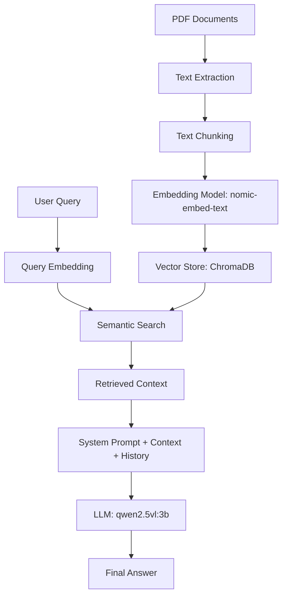

# Personal RAG Assistant 🤖

A professional implementation of a **Retrieval-Augmented Generation (RAG)** system designed to answer questions about a specific set of documents (e.g., a professional resume) using local LLMs and vector embeddings.

## 📌 Project Overview
This project demonstrates a full RAG pipeline: converting unstructured PDF documents into a searchable vector database and using a Large Language Model (LLM) to generate grounded answers based on the retrieved context.

### Problem Statement
LLMs often suffer from "hallucinations" when asked about specific, private, or recent data not present in their training set. RAG solves this by providing the LLM with relevant snippets of external documents before generating a response.

### Objectives
- Implement a local-first AI pipeline for data privacy.
- Demonstrate semantic search using vector embeddings.
- Build a conversational interface with memory (chat history).

## 🏗️ RAG Architecture



## 🛠️ Technologies Used
- **Language:** Python 3.11+
- **LLM Orchestration:** [Ollama](https://ollama.com/)
- **Models:** 
  - `nomic-embed-text` (for embeddings)
  - `qwen2.5vl:3b` (for generation)
- **Vector Database:** [ChromaDB](https://www.trychroma.com/)
- **PDF Processing:** `pypdf`

## 🚀 Getting Started

### Prerequisites
1. Install [Ollama](https://ollama.com/).
2. Pull the required models:
   ```bash
   ollama pull nomic-embed-text
   ollama pull qwen2.5vl:3b
   ```

### Installation
1. Clone the repository:
   ```bash
   git clone https://github.com/your-username/personal-rag-assistant.git
   cd personal-rag-assistant
   ```
2. Install dependencies:
   ```bash
   pip install -r requirements.txt
   ```

### Execution
You can run the system using the provided Jupyter Notebook for a visual demonstration:
1. Open `notebook/rag_demo.ipynb`.
2. Follow the steps to index your documents and start chatting.

## 🧪 Example Workflow
1. **Input:** "What are Abhinandh's technical skills?"
2. **Process:** 
   - Query is embedded.
   - ChromaDB retrieves chunks containing "Technical Skills".
   - LLM generates: "Abhinandh is proficient in Python, JavaScript, PyTorch, YOLOv8, and the MERN stack."
3. **Output:** Grounded answer with no hallucinations.

## 📈 Limitations & Future Improvements
- **Current Limitation:** Basic sliding-window chunking. 
- **Improvement:** Implement recursive character splitting or semantic chunking.
- **Current Limitation:** Single-document focus.
- **Improvement:** Implement a multi-document management system with metadata filtering.
- **Improvement:** Add a Streamlit frontend for a more polished user experience.
